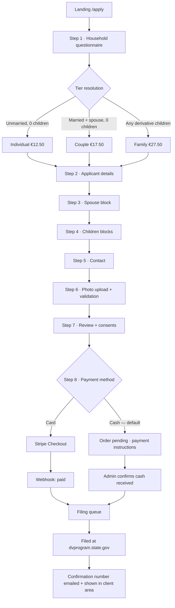
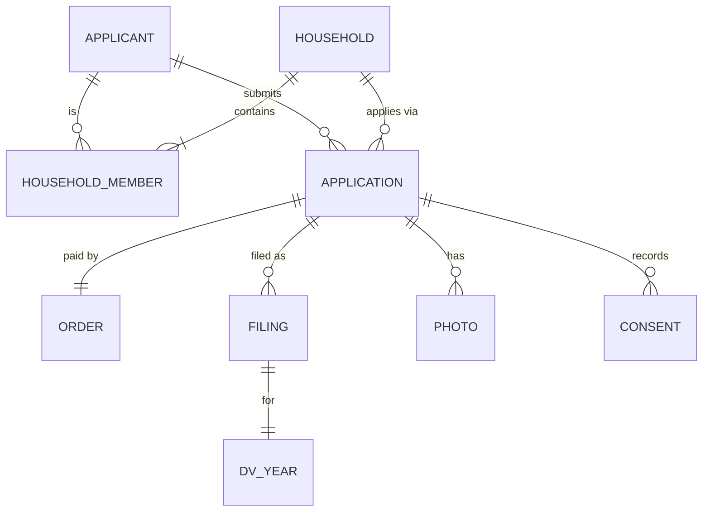

# GCK Application Platform — Project Blueprint

**Client:** N.Sh. Green Card Kosova
**Product:** Public DV-lottery application funnel + tiered pricing + Stripe / cash-on-delivery payments + back office
**Version:** 1.0 — 22 Oct 2026
**Status:** Draft for client sign-off

---

## 0. One-paragraph summary

Replace the current `greencardkosova.com/apply2` form with a modern, mobile-first, bilingual (SQ/EN) application platform. The applicant answers a short household questionnaire, the system derives the correct price tier automatically (Individual / Couple / Family), collects all DV-required data and photos with validation, then routes to payment — **cash on delivery/post is the default**, Stripe card payment is the alternative. Every application lands in an admin back office where staff review, mark payment received, file the entry at `dvprogram.state.gov`, and record the confirmation number, which is automatically emailed to the client and visible in their client area.

---

## 1. Scope

### In scope (MVP)

| # | Area | Included |
|---|------|----------|
| 1 | Public funnel | Multi-step application form, SQ + EN, mobile-first |
| 2 | Pricing engine | Automatic tier resolution from household answers |
| 3 | Payments | Cash-on-delivery (default) + Stripe Checkout (card) |
| 4 | Photo pipeline | Upload, spec validation, cropping, secure storage |
| 5 | Client area | Status timeline, confirmation number, receipts, document upload |
| 6 | Admin | Queue, review, cash reconciliation, filing, exports, audit log |
| 7 | Notifications | Transactional email (SQ/EN), optional SMS |
| 8 | Compliance | Privacy policy, consents, disclaimers, retention, deletion |
| 9 | Analytics | Funnel + revenue, no PII |

### Out of scope (MVP) — phase 2 candidates

- Embassy/interview scheduling and document coaching after selection
- Automated DV submission (see §5.4 — no public API exists)
- Affiliate/referral program
- Native mobile app
- Multi-currency (EUR only in MVP)

---

## 2. Pricing & tier rules

### 2.1 Packages (client-supplied)

| Package | Albanian label | Price | Applies when |
|---|---|---|---|
| Individual | Aplikim Individual | **€12.50** | Single / unmarried, no derivative children |
| Couple | Aplikim për Çifte | **€17.50** | Married, spouse included, no derivative children |
| Family | Aplikim Familjar | **€27.50** | Married with unmarried children under 21 |

Prices are **flat per application**, not per person. Three children do not cost more than one. Amounts stored in cents (`1250`, `1750`, `2750`), currency `EUR`.

### 2.2 Resolved decision table

| Marital status | Spouse included | Derivative children* | Tier | Price |
|---|---|---|---|---|
| Unmarried (single / divorced / widowed) | — | 0 | Individual | €12.50 |
| Unmarried | — | ≥1 | **Family** ⚠️ | €27.50 |
| Married | Yes | 0 | Couple | €17.50 |
| Married | Yes | ≥1 | Family | €27.50 |
| Married | No (US-citizen spouse / legal separation) | 0 | **Individual** ⚠️ | €12.50 |
| Married | No | ≥1 | **Family** ⚠️ | €27.50 |

\* **Derivative child** = unmarried **and** under 21 at the time of entry. Married children and children 21+ are **not** derivatives, are not entered, and do not affect price.

Rows marked ⚠️ are not covered by the client's rules and need a written decision — see §16 Q2/Q3. Recommended defaults are shown.

### 2.3 Rules the engine must enforce

1. The tier is **derived, never user-selected**. The user never sees a price list they can game; they answer questions and the price appears.
2. A **price snapshot** (`tier`, `amount_cents`, `currency`, `rules_version`) is frozen onto the order at checkout. Later rule changes never mutate historical orders.
3. Children are collected as structured records (name, DOB, gender, birth country, photo) — the count drives the tier, the records drive the DV entry.
4. Number of children is **not** a price multiplier.
5. Manual override exists in admin only, with a mandatory reason, written to the audit log.

### 2.4 DV domain rules the form must respect

These are correctness rules, not pricing rules, but they live in the same engine:

- A married applicant **must** list their spouse unless the spouse is a US citizen or the couple is legally separated. Refusing to list a spouse makes the entry invalid.
- **All** unmarried children under 21 must be listed, even if they will not immigrate.
- **One entry per person per DV year.** Duplicate entries disqualify the applicant. The system must run a duplicate check (normalised name + DOB + email) and block/warn before submission.
- Country of birth must be DV-eligible; Kosovo is eligible, but the check must be data-driven per year.
- Education: high school completion **or** 2 years of qualifying work experience in the last 5 years.

---

## 3. User flows

### 3.1 Main funnel



### 3.2 Key UX requirements

- **Progress is saved automatically** after every step. Resume link by email — the family flow is long (5+ people, 5 photos) and will be abandoned otherwise.
- Step 1 must take under 30 seconds and immediately reveal the price — this is the conversion moment.
- Conditional blocks (spouse, children) appear only when relevant, with a visible "why we ask" note.
- Inline validation, Albanian-first copy, no dead ends.
- Works on a €120 Android phone on 3G. Target LCP < 2.5 s.
- **No account required to apply.** Account is created/claimed after submission via emailed magic link.

### 3.3 Client area

| Screen | Contents |
|---|---|
| Dashboard | Application status timeline, price paid, next action |
| My application | Read-only view of submitted data, edit-request button |
| Photos | Upload/replace, validation result, retake guidance |
| Payment | Method, amount, receipt download, outstanding balance |
| Confirmation | DV confirmation number, copy button, PDF receipt |
| Documents | Post-selection uploads (phase 2 placeholder) |

### 3.4 Admin flows

1. **Triage queue** — new applications, missing photos, failed validation, duplicates.
2. **Cash reconciliation** — list of `pending_cash` orders with reference codes; mark received (date, amount, received-by, method: post / office / bank).
3. **Filing** — per DV year, a work queue; staff open the record, file at the official site, paste the confirmation number, mark `filed`.
4. **Photo review** — approve/reject with reason.
5. **Exceptions** — refunds, chargebacks, deadline-risk applications.
6. **Reporting** — revenue by method, outstanding cash, conversion by step, filings vs deadline.

---

## 4. Payments

### 4.1 Method A — Cash on delivery / by post (DEFAULT)

Selected by default in the UI, per client instruction. Mechanics:

1. Order created with `payment_method = cash`, status `pending_cash`, and a **short human reference** (e.g. `GCK-7F3K2`).
2. Applicant sees instructions: amount, reference, office address, phone, and the postal option.
3. No application is filed until cash is confirmed — the reference code is mandatory on every envelope/money transfer.
4. Staff mark the order paid in admin; the client gets an SMS/email receipt automatically.
5. `pending_cash` orders **expire** at the DV-window close date, or after N days of inactivity (client to set N).

**Safeguards required** for cash-by-post: mandatory reference code, daily reconciliation report, double-entry (operator + accountant), never accept cash without a receipt, and a hard rule that no one edits a paid amount without an audit entry.

### 4.2 Method B — Stripe (card)

- **Stripe Checkout (hosted)**, not custom card fields. Keeps PCI scope at SAQ A, gives 3-D Secure, Apple Pay, Google Pay for free.
- Flow: create `Checkout Session` server-side with the frozen amount → redirect → `checkout.session.completed` webhook → mark paid (idempotent, keyed on `session.id`).
- Also handle `payment_intent.payment_failed`, `charge.refunded`, `charge.dispute.created`.
- Never trust the browser redirect alone; **only the webhook is authoritative**.
- Store only Stripe IDs — no card data ever touches our servers.

### 4.3 ⛔ Blocker: Stripe does not support Kosovo merchants

Stripe's global availability list does not include Kosovo. A Kosovan entity cannot open a standard Stripe account. Options, in order of practicality:

| Option | Notes |
|---|---|
| **Local PSP / bank gateway** (ProCredit, Raiffeisen, Banka Ekonomike, etc.) | Realistic for a Kosovo business; usually supports EUR cards and 3-D Secure; API quality varies |
| **EU/UK/US entity for the merchant account** | Requires a real registered company + bank account in that country; tax and payout complexity |
| **Merchant of Record** (Paddle, Lemon Squeezy) | Handles VAT, but immigration-consulting services may be on their restricted list — must be cleared in writing |
| Stripe via a partner/platform | Only if a platform already has a compliant entity — adds margin and risk |

**Decision required before payment work starts.** The code should be written against a `PaymentProvider` interface so Stripe or a local PSP can be swapped without touching the funnel.

### 4.4 Refunds & cancellation

- Before filing: full refund, both methods.
- After filing: no refund — the DV entry is irreversible and cannot be withdrawn.
- Card refunds via Stripe/local PSP; cash refunds recorded manually with a signed receipt.
- Digital-service withdrawal right: the checkout must capture explicit consent to **immediate performance** and acknowledgement that the right of withdrawal is lost once the entry is filed.

### 4.5 Money states (kept separate from case status)

```
Order:    created → pending_cash | pending_card → paid → refunded | disputed | expired
```

Never overload the application status with payment state. Two independent machines, joined in the UI.

---

## 5. Domain model

### 5.1 The four-level model

The current site conflates "a person", "this year's application" and "the entry filed with the government". That breaks the moment someone applies for three years in a row. Model it properly:



| Entity | Meaning | Reused across years |
|---|---|---|
| `Applicant` | A human being (name, DOB, contact) | ✅ permanent |
| `Household` | Applicant + spouse + children as a unit | ✅ permanent |
| `HouseholdMember` | Role: applicant / spouse / child, with DOB & marital status | ✅ permanent |
| `Application` | One engagement for one DV year (the case) | ❌ per year |
| `Order` | What was charged, how, when | ❌ per year |
| `Filing` | The actual government submission: date, confirmation number, staff member | ❌ per year |

This is what makes "we re-apply you every year automatically" a feature instead of a data-entry nightmare.

### 5.2 Core tables

```
applicants        id, first_name, last_name, dob, gender, birth_city, birth_country,
                  email, phone, address..., created_at
households        id, applicant_id, created_at
household_members id, household_id, role, first_name, last_name, dob, gender,
                  birth_city, birth_country, marital_status, education_level,
                  is_derivative (bool), include_in_entry (bool)
applications      id, public_ref, applicant_id, household_id, dv_year_id,
                  tier, amount_cents, currency, rules_version,
                  status, data_json, submitted_at, created_at
photos            id, application_id, member_id, storage_key, bytes, width, height,
                  validation_json, status (pending|valid|invalid|approved|rejected),
                  reviewed_by, reviewed_at
orders            id, application_id, amount_cents, currency, method (cash|card),
                  status, provider, provider_ref, paid_at, received_by, cash_note,
                  refunded_at, refund_reason
filings           id, application_id, dv_year_id, confirmation_number,
                  filed_at, filed_by, receipt_key, notes
dv_years          id, year_label, opens_at, closes_at, is_eligible_countries_json,
                  is_active
notifications     id, application_id, type, channel, locale, status, sent_at, error
consents          id, application_id, type (terms|privacy|withdrawal|guardian),
                  version, accepted_at, ip_hash, user_agent
audit_log         id, actor_type, actor_id, entity, entity_id, action, diff_json, at
admin_users       id, email, role (admin|operator|accountant|viewer), totp_secret
attribution       id, application_id, utm_source, utm_campaign, fbclid, referrer
```

### 5.3 Application status machine

```
draft → submitted → in_review → ready_to_file → filed → confirmation_sent
                                                    ↘ selected | not_selected
     ↘ cancelled | expired | rejected | refunded
```

- `submitted` = data complete + consents given (payment may still be pending).
- `ready_to_file` = paid **and** photos approved **and** duplicate check clear.
- `filed` requires a confirmation number — it cannot be set without one.
- Filing is **manual** by staff; no automation exists (see §5.4).

### 5.4 Important constraint: the DV program has no API

`dvprogram.state.gov` accepts entries through a web form for a human, during a limited annual window. There is no public API, and automated submission would violate the site's terms. Therefore:

- "Auto-submit every year" is an **internal workflow**, not an integration.
- The platform's job is to make staff filing fast: one screen per case, data laid out in DV field order, copy-to-clipboard per field, confirmation number capture.
- The customer-facing promise must be worded as "we prepare, review and submit your entry" — never "instant automatic government submission".

---

## 6. Technical architecture

### 6.1 Stack

| Layer | Choice | Why |
|---|---|---|
| Framework | **Next.js 15 (App Router) + TypeScript** | SSR for SEO, one codebase for site + admin + API |
| UI | Tailwind CSS + shadcn/ui | Fast, consistent, accessible primitives |
| DB | **PostgreSQL** (Neon / Supabase / self-hosted) | Relational integrity matters here |
| ORM | Drizzle | Typed schema, explicit migrations, easy raw SQL for reports |
| Auth | Auth.js (credentials + magic link) | Simple, self-hosted, no per-user cost |
| Payments | Provider interface → Stripe Checkout or local PSP | Decoupled from the blocker in §4.3 |
| Email | Resend or Postmark | Deliverability + templates |
| SMS | Twilio / local aggregator | Optional, Kosovo numbers |
| Files | S3-compatible object storage (R2 / Hetzner) | Private buckets, signed URLs |
| Hosting | Vercel (app) + EU-region storage | Or Hetzner CX/CPX in Falkenstein for cost + latency |
| Analytics | Plausible | Cookieless, avoids a consent banner for stats |
| i18n | next-intl | SQ default, EN secondary, `/sq` `/en` routes |

### 6.2 Project layout

```
/app
  /[locale]
    /(public)          landing, apply funnel, legal pages
    /(client)          authenticated client area
  /admin               role-guarded back office
  /api
    /webhooks/stripe
    /photos            signed upload URLs
    /applications      draft autosave
/lib
  /pricing             tier engine (pure, unit-tested)
  /dv                  DV field mapping, eligibility, duplicate check
  /payments            provider interface + adapters
  /photos              validation, EXIF strip, resize
  /notifications       templates, queues
/db
  schema.ts, migrations/
/tests
  pricing.test.ts, e2e/
```

### 6.3 The pricing module is pure and testable

No DB, no UI, no side effects — input in, tier out. This is the single most important unit-tested piece of the project. See `docs/pricing-engine.md`.

### 6.4 Photo pipeline

DV photo spec must be enforced before the client ever sees "submitted":

1. Upload to a private bucket via pre-signed URL (never through the app server).
2. Validate: JPEG, **600×600 – 1200×1200 px**, **≤ 240 KB**, square, head centred, plain background, no glasses/hats (best-effort face check).
3. Auto-crop/fix where safe; otherwise return specific, human-readable retake instructions in Albanian.
4. Strip EXIF/GPS.
5. Store original + processed; signed URLs expire in 15 min.
6. Verify the current year's spec at build time and store it in `dv_years` — the US rule changes.

### 6.5 Security baseline

| Control | Requirement |
|---|---|
| Transport | HTTPS only, HSTS, HTTP→HTTPS 301 |
| Headers | CSP, X-Frame-Options DENY, X-Content-Type-Options, Referrer-Policy |
| CSRF | Token on every state-changing request |
| Rate limiting | Per IP + per email on funnel, login, magic link |
| Bot protection | Cloudflare Turnstile on submit (invisible) |
| Uploads | MIME sniffing, size caps, AV scan, stored outside webroot |
| Admin | Mandatory TOTP 2FA, RBAC, session timeout 30 min |
| Encryption | TLS in transit; at-rest encryption for DB and photos |
| Secrets | Platform secret store, never in repo |
| Backups | Daily DB snapshots, 30-day retention, quarterly restore test |
| Audit | Every admin read/write of PII logged |
| PII in logs | Forbidden — redact email/phone in app logs |
| Analytics | No PII, no cross-site tracking |

### 6.6 Compliance requirements (build these, don't bolt on later)

1. **Independent-service disclaimer** on the landing page, at checkout, and in every email: not affiliated with the US government; the DV entry itself is free at `dvprogram.state.gov`; the fee is for preparation and submission services.
2. **Privacy policy** (SQ + EN) covering: what is collected, why, legal basis, retention, processors (Stripe, email, hosting), data subject rights, contact.
3. **Parental consent** for every minor's data — a specific, logged consent from the parent/guardian per child.
4. **Consent records** with policy version, timestamp, IP hash.
5. **Retention policy**: non-selected applicants deleted or anonymised after 24 months unless they opt into annual re-application; selected cases retained 7 years for tax/legal; photos deleted 90 days after filing unless retained for a documented reason.
6. **Data subject requests**: export and delete flows in admin.
7. **VAT/tax**: confirm treatment of digital services with the client's accountant (Kosovo VAT and any EU OSS obligation).
8. **Invoicing**: every payment produces a numbered receipt/invoice with the legal entity details.

---

## 7. Content & localization

- **Albanian is the default language.** English is secondary (diaspora + international).
- All copy written by a native speaker, not machine-translated — the current site's Albanian has visible grammar errors that undermine trust.
- Legal pages in both languages, versioned.
- Error messages must say what to do next ("Fotografia është 480×480 px — duhet të jetë së paku 600×600 px. Provo përsëri.").
- Tone: plain, specific, no guarantees of winning.

---

## 8. Analytics & KPIs

Funnel events (no PII): `apply_started`, `tier_resolved` (tier only), `step_completed` (step number), `photo_failed` (reason code), `checkout_viewed`, `payment_method_selected`, `order_paid`, `application_filed`.

Dashboards:

- Conversion by step → find the drop-off.
- Tier mix (Individual / Couple / Family).
- Payment method split + **outstanding cash balance** (the number the accountant cares about).
- Time from paid → filed, vs. the DV deadline.
- Cost per application from Facebook ads (fbclid → attribution table).

---

## 9. Delivery plan

Assumes **1 full-stack developer + part-time designer**, client responds to decisions within 3 working days.

| Phase | Weeks | Deliverable | Exit criteria |
|---|---|---|---|
| **0 · Decisions** | 1 | Signed answers to §16 blockers, Stripe/PSP decision, legal entity details | No ⛔ items open |
| **1 · Design** | 1–2 | Wireframes for 8-step funnel, client area, admin; SQ/EN copy deck | Client approves flow + pricing display |
| **2 · Core funnel** | 2–3 | Steps 1–7, pricing engine, autosave/resume, photo upload + validation | All 3 tiers produce correct price in automated tests |
| **3 · Payments** | 1–2 | Provider adapter, checkout, webhooks, cash instructions, reconciliation | Test card + test cash order both reach `paid` |
| **4 · Admin + filing** | 2 | Queue, review, cash marking, filing screen, confirmation capture, audit log | Staff can process a case end-to-end in < 5 min |
| **5 · Client area + email** | 1 | Magic-link auth, status timeline, receipts, confirmation PDF | Client can self-serve without calling |
| **6 · Hardening** | 1–2 | Security headers, rate limits, backups, accessibility pass, load test | Lighthouse ≥ 90 mobile; pen-test checklist clean |
| **7 · Launch** | 1 | Migration of active clients, DNS, monitoring, staff training | First 10 real applications processed without escalation |

**Total: 8–11 weeks** to public launch, excluding client-side legal/PSP setup, which is usually the critical path.

### Launch checklist

- [ ] Privacy policy + terms + disclaimer live in SQ and EN
- [ ] Refund and withdrawal wording approved
- [ ] PSP live keys + webhook secret in production
- [ ] Cash instructions page printed for the office
- [ ] Retention job scheduled and tested
- [ ] Backups verified by an actual restore
- [ ] Staff trained on the filing screen and cash reconciliation
- [ ] Monitoring + error alerting to a real phone
- [ ] Legal entity + invoice numbering confirmed

---

## 10. Risks

| Risk | Impact | Mitigation |
|---|---|---|
| **Stripe unavailable in Kosovo** | No card payments | Decide PSP in phase 0; abstract the provider |
| Cash by post is unprovable | Revenue leakage, disputes | Mandatory reference code, daily reconciliation, receipts |
| DV deadline is fixed and unforgiving | Unfiled paid applications | Deadline-aware queue, "days remaining" banner, escalation at T-7 |
| Photos rejected by the official system | Invalid entries, angry clients | Strict pre-validation + human photo review before filing |
| Duplicate entries | Disqualification | Automated duplicate check at submit and at filing |
| Handling minors' data | Legal exposure | Per-child guardian consent, minimisation, retention limits |
| Rule ambiguity (single parent, spouse excluded) | Wrong price charged | §16 decisions before phase 2 |
| €750 post-selection ambiguity | Billing disputes | Written terms + checkout disclosure |

---

## 11. Open questions — client must answer

**Blocking (phase 0):**

1. ⛔ **Is the old €750-per-family post-selection fee still charged?** The current terms page says it is. The new price list (€12.50/17.50/27.50) reads like a complete fee. If both exist, the checkout must disclose €750 before purchase, or you will get chargebacks.
2. ⛔ **Single parent with children** — Individual or Family? (Recommended: Family.)
3. ⛔ **Married but spouse not included** (US citizen spouse / legal separation) — Individual or Couple? (Recommended: Individual; reason captured.)
4. ⛔ **Cash mechanics**: posted cash, in-office cash, or bank transfer? Who bears loss in transit? What is the payment deadline before the order expires?
5. ⛔ **Card processor**: local bank gateway, foreign entity, or merchant-of-record? Business entity name and country for the merchant account.
6. ⛔ **Does the €12.50/17.50/27.50 cover one DV year only?** What is charged for automatic re-application next year?

**Non-blocking:**

7. Refund window before filing (recommended: 14 days or until filed, whichever is first).
8. Retention period for unsuccessful applicants (recommended: 24 months).
9. Legal entity details for invoices + VAT treatment.
10. Do we migrate existing clients from the old system, or start clean?
11. SMS notifications — yes/no, and which provider.
12. Will the client keep the current domain, or launch on a new one?

---

## 12. Definition of done (MVP)

- An applicant on a phone can go from landing page to paid order in **under 6 minutes** for Individual, **under 12** for Family.
- All three tiers resolve correctly, including the edge cases in §2.2, verified by automated tests.
- A cash order and a card order both reach `paid` and appear identically in the filing queue.
- Staff can file an entry and record a confirmation number in one screen.
- The client receives the confirmation number by email and sees it in their account.
- No PII in analytics, logs, or URLs.
- Legal pages, disclaimers and consents are live in both languages.
- Backup restore has been performed once, successfully.

---

## Appendix A — Pricing engine (reference)

The full decision table, reference TypeScript implementation and test matrix live in [`docs/pricing-engine.md`](docs/pricing-engine.md).

## Appendix B — Screens inventory

| # | Screen | Auth | Notes |
|---|---|---|---|
| 1 | Landing `/` | public | Hero, tiers, trust, FAQ, apply CTA |
| 2 | Apply step 1–8 | public | Autosave, resume by email |
| 3 | Order confirmation | public | Reference code, payment instructions |
| 4 | Card checkout | public | Hosted by PSP |
| 5 | Client login | public | Magic link |
| 6 | Client dashboard | client | Status timeline |
| 7 | Client application view | client | Read-only + edit request |
| 8 | Client payment/receipt | client | PDF download |
| 9 | Legal: terms / privacy / disclaimer | public | Versioned, SQ + EN |
| 10 | Admin dashboard | admin | KPIs, deadlines |
| 11 | Admin applications list | admin | Filters: status, tier, payment, year |
| 12 | Admin application detail | admin | Review, approve, override |
| 13 | Admin cash reconciliation | accountant | Mark paid, export |
| 14 | Admin filing screen | operator | DV field order, copy buttons, confirmation capture |
| 15 | Admin photo review | operator | Approve/reject with reason |
| 16 | Admin users + audit log | admin | RBAC, 2FA enforcement |

## Appendix C — Environment variables

```
DATABASE_URL
NEXTAUTH_SECRET
APP_BASE_URL
PAYMENT_PROVIDER=stripe|local
STRIPE_SECRET_KEY
STRIPE_WEBHOOK_SECRET
STORAGE_ENDPOINT / STORAGE_BUCKET / STORAGE_KEY / STORAGE_SECRET
RESEND_API_KEY
TURNSTILE_SITE_KEY / TURNSTILE_SECRET_KEY
DV_YEAR=2027
```
